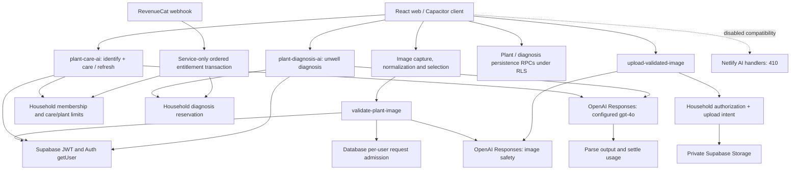

# PlantieCare AI architecture baseline — Step 1

Audit date: **2026-11-15**, Europe/Bratislava. Application: live PlantieCare. Repository: `M3ybi/FlowerScan`, branch `main`, revision **`49dc7bad253d0eacb4b2a34f22f214d15f68346e`**. Local HEAD and `git ls-remote origin refs/heads/main` matched. The initial working tree was clean.

**Recommendation: NO-GO for Step 2 as a production Luna/Terra architecture change.** The existing application checks pass, but provider cost/quality baselines are missing, care generation has replay and pre-spend admission gaps, and the intended Luna/Terra model IDs and routing contract have not been specified. The gates below define the work needed to reconsider this decision. This is not a finding that anonymous users can currently obtain Premium or invoke the protected production AI routes.

## 1. Scope, method and evidence rules

This audit examined current source, current deployed Edge bundles, production configuration metadata, database catalog definitions/permissions, aggregate counters and a bounded log window. It did not treat historical deployment reports as proof of present state.

The only tracked file created is this report. No application code, dependency, lockfile, migration, branch, production data, Premium entitlement, provider setting, model, function or deployment was changed. Local test commands generated ignored build/test artifacts; audit logs were written under `%TEMP%/plantie-ai-audit-20261115/`. No real AI request, purchase, cancellation, upload, email or authenticated business mutation was initiated. Production SQL used `BEGIN READ ONLY` and `ROLLBACK`; only catalog/configuration data and aggregate counts were selected. No customer records, photos, prompts, tokens or secret values are included here. Existing authenticated provider access was used without printing credentials. Model/configuration digest comparisons were performed in memory.

Status vocabulary throughout:

- **PASS**: the named check was executed and its stated assertion held, within the stated scope.
- **FAIL**: a check was executed and reported a failure, or a reviewed invariant is demonstrably absent. A passing reproduction can establish a failing product invariant.
- **NOT EXECUTED**: no qualifying execution or measurement exists in this audit. Historical results are not substituted.

Required reading completed: root `AGENTS.md` and the supplied workspace instructions; `README.md`; `docs/image-upload-pipeline.md`; `docs/revenuecat-subscriptions.md`; `docs/revenuecat-billing.md`; and `docs/v4-production-deployment.md`. Relevant release configuration, CI, tests, SQL migrations, image/authorization helpers and frontend orchestration were inspected alongside those documents. Supabase changelog and official OpenAI model/vision documentation were consulted for compatibility and cost interpretation.

## 2. Source versus current deployed state

### Production readback

| Verification | Status | Evidence and boundary |
| --- | --- | --- |
| Requested repository/main revision | PASS | Local HEAD and remote main both `49dc7bad…`; no branch was created. |
| Current web deployment | PASS | Netlify API reports repository `M3ybi/FlowerScan`, branch `main`, published revision `49dc7bad…`, state `ready`. |
| Served web artifact | PASS | `https://plantiecare.com/plantie-release.json`: same revision, `dirty=false`, `environment=production`, `billingMode=web_sandbox`; its entry `assets/index-FAk5PbpU.js` returned 200 and matched the manifest SHA-256. Backend fingerprint matched the existing Plantie project. |
| Production backend/project | PASS | Existing Plantie project `hzigkjukqpxryziscvag`, eu-central-1, ACTIVE_HEALTHY, PostgreSQL 17.6.1.155. Frontend configuration selects Supabase. |
| Active Supabase model override | PASS | Management API secret metadata contains `OPENAI_MODEL`; its digest equals the locally calculated digest of **`gpt-4o`**. No secret value or digest is published. |
| OpenAI availability/resolved snapshot | NOT EXECUTED | No paid request was sent. `gpt-4o` is the configured alias; the provider-returned model/snapshot is not measured. |
| Netlify AI configuration | PASS | Function-scope readback selects **`gpt-4o-mini`**, but `ENABLE_NETLIFY_LEGACY_BACKEND` is not enabled. Anonymous empty POSTs to both Netlify AI handlers returned **410** before model work. This is an inactive compatibility configuration, not the active Supabase model. |
| Production receipt optimization | PASS | `IMAGE_VALIDATION_SIGNING_SECRET` is absent from Supabase secret metadata. Validation therefore issues no signed receipt, and upload performs its own safety model call. Existing safety enforcement remains active. |
| Billing mode and sandbox flags | PASS | Supabase digests match `REVENUECAT_BILLING_MODE=test_store` and the narrow Web Billing sandbox flag `true`; broad sandbox opt-in is absent. Web manifest/configuration selects `web_sandbox`. |

All three Supabase provider call sites independently select `Deno.env.get("OPENAI_MODEL") || "gpt-4o"`. The source default and deployed override currently agree. `.env.example` is an example, not production evidence. The Netlify setting does not configure Supabase.

Deployed bundle readback was compared to local source after CRLF/LF normalization:

| Function | Active version | Gateway JWT | Compared files | Result |
| --- | ---: | --- | ---: | --- |
| `plant-care-ai` | 17 | true | 9 | PASS — all equal |
| `plant-diagnosis-ai` | 19 | true | 9 | PASS — all equal |
| `validate-plant-image` | 12 | true | 12 | PASS — all equal |
| `upload-validated-image` | 14 | true | 12 | PASS — all equal |
| `revenuecat-webhook` | 13 | false; handler secret required | 6 | PASS for current authorization/environment behavior; source parity has one additive difference |

The webhook's deployed `src/lib/revenueCatEnvironment.ts` lacks the unused `isRevenueCatWebSandboxKey` export now present on main. The `isRevenueCatEnvironmentAllowed` implementation is identical. This is source drift to retain in deployment records, not evidence of different webhook environment admission.

The V4 document records an earlier blocked Netlify rollout and earlier function versions. Those historical blockers do not describe today's verified web deployment. Its warnings about missing authenticated/provider/device acceptance remain relevant; this audit does not close them.

## 3. Current architecture and execution paths

The diagram separates HTTP operations; there is no shared end-to-end transaction across the provider, Storage and Postgres. No agent orchestration, RAG, vector retrieval, external model tools, server-side plant-history retrieval or Luna/Terra routing exists in the inspected AI paths. Calls are individual, non-streaming Responses API requests using one image and strict JSON Schema. Language instructions cover English, Slovak, German, French and Spanish; schema keys/enums/scientific names remain stable.

### Add New Plant and identification

1. `useImageSelection` captures a browser File or Capacitor photo, normalizes it, calls `validatePlantImageForUpload`, and preserves the previous preview if replacement fails. Scope changes clear image receipts and discard stale selection results.
2. `usePlantActions.handleAddCustomFlower` uses a synchronous submission symbol and a pending legacy plant ID. `addPlantFromPhoto` checks `assertCanAddPlant`, then calls `fetchGeneratedCare` with `generationSource=initial_plant_add`.
3. `plant-care-ai` authenticates with `requireUser`, bounds/parses JSON and JPEG bytes, checks household UUID/name, calls `assert_can_add_plant`, admits a `care` request, then sends the photo and supplied name to OpenAI. Identification and care are produced together, not by separate models.
4. The server parses/sanitizes a `care` object. Initial generation has no server operation/plant binding and records no usage at this point.
5. `upsertSupabasePlantFromFlower` uploads through `upload-validated-image`, then calls `create_household_plant`. That invoker RPC inserts parent/children atomically under RLS, checks the plant limit through a trigger and records initial care generation when tips exist. This record describes saved initial care, not every provider attempt.
6. Persistence reconciles ambiguous writes by rereading the legacy ID before deleting an image. Existing photo paths are retained until a replacement commits. Retrying the form can rerun generation even when a pending plant ID survives.

### Plant Looks Unwell and diagnosis

1. `useDiagnosisActions` checks the selected household's access/usage and uses the same image-selection safety flow. The user supplies one affected-part image, a plant name and optional symptom notes. Neither care history nor watering records are sent to the model.
2. `fetchPlantDiagnosis` calls `plant-diagnosis-ai` through the default Supabase backend. The request includes household, name, notes, language and image; **it does not include plant ID or a safety receipt**.
3. The Edge handler authenticates, validates transport/JPEG, admits `diagnosis`, and calls `reserve_ai_analyze_usage`. Membership and the household Free allowance are server-side checks. Premium returns a null reservation; Free obtains a reservation under the household lock.
4. After OpenAI, the handler rejects incomplete/failed responses and malformed output. On a valid result it commits through the service-role client. Provider/network/parse/commit failures attempt release. Release errors are safely logged; stale Free reservations are recoverable after two minutes on later usage/reservation checks.
5. A successful generation consumes Free allowance **before** the user chooses to save. Saving uploads the image and invokes `create_plant_diagnostic`, which derives household from an accessible plant and inserts diagnosis/children atomically. A failed save or abandoned draft does not refund a completed generation.
6. Saved diagnosis content is supplied by the client; persistence does not cryptographically prove that it originated in a paid/reserved generation. This is a provenance limitation, not a demonstrated ability to obtain an additional diagnosis provider call through that persistence RPC.

### Manual care recommendation refresh

1. `useCareActions` currently uses `resolveCurrentAiDiagnosisAccess`, the same UI access helper as diagnosis. Thus a Free household with no monthly diagnoses remaining can be blocked in the UI even when its separate daily care allowance is available.
2. The client reads the stored plant under RLS, obtains a private image signed URL (default five minutes), fetches and normalizes the image, then calls `fetchGeneratedCare` with household, plant ID and `manual_refresh`.
3. The server checks `assert_can_generate_care_tip`, admits `care`, calls OpenAI, parses the result, and only then calls `record_care_tip_generation`. The latter locks/rechecks the daily quota. A concurrent loser can incur provider cost and receive 409.
4. Usage is consumed when a preview is returned, before the user's confirmation. Confirming applies generated care through existing plant persistence. It is not another model call. Discarding a preview does not refund its recorded daily generation.

### Image validation, storage, retries and cancellation

- Originals: maximum **15 MiB**. JPEG/PNG/WebP and signature-detected HEIC/HEIF go through client decode/orientation/metadata removal. HEIC fallback is lazy and worker-isolated, with a software decode pixel bound of 16,777,216.
- Normalized contract: JPEG, maximum **2,097,152 bytes**, longest side **1600 px**, no upscaling; quality attempts 0.85, 0.75, 0.65, then reduced dimensions at 0.65. Preferred 1 MiB is not a hard target. Five attempts are made from the original decoded image.
- Backend body bound: **2,812,611 bytes**; maximum data URL **2,796,227 characters**. `_shared/imageUpload.ts` checks declared and streamed sizes before parsing. Shared validation checks base64, decoded size, JPEG markers/dimensions and selected private metadata segments. It is structural validation, not a full independent JPEG pixel decode; provider decoder failures remain possible.
- Safety requires a botanical subject, confidence at least 0.75, all unsafe/private flags false, permission true and no failure reasons. Invalid/malformed model validation fails closed. The public message is mapped locally; provider bodies are not returned by the active Supabase image handlers.
- `validate-plant-image` requires a valid account and per-user admission, but no household or plan. `upload-validated-image` additionally checks active household content membership, validates bytes and admits an upload. It verifies an optional signed receipt or runs safety itself, then reserves upload capacity and writes with the service client.
- Optional receipts are HMAC-SHA256 capabilities bound to exact bytes, user, upload action and five-minute expiry. They do not authorize a household. Receipt omission triggers validation; an invalid supplied receipt is rejected. With no production signing secret, normal selection plus save repeats safety validation.
- Paths are canonical household/UUID paths in private `plant-images` / `diagnostic-images` buckets. Service upload uses `upsert=true` for old-client compatibility. New replacements use fresh paths; referenced old photos are preserved until commit. Upload intent admission caps unclaimed paths at 20 per household and rechecks membership after the household lock.
- One automatic upload retry is allowed only for explicit `IMAGE_VALIDATION_REQUIRED`, clearing the receipt and revalidating. Ambiguous provider/model/upload errors have no general automatic retry. A new user action can incur another paid attempt. Lower-level file reading has a bounded retry for transient gallery failures.
- Image selection aborts file/worker/validation work and rejects stale results. Client API timeouts are 60 seconds; safety provider timeout is 15 seconds, care/diagnosis fetch timeout is 30 seconds. Image downloading for refresh has a 30-second client timeout. These are configured limits, not latency measurements or whole-workflow SLAs.
- Care/diagnosis callers do not pass a user cancellation signal. Closing diagnosis is disabled during generation/save. Scope checks prevent subsequent stale UI/persistence work, but do not cancel provider spend already in flight. The Edge provider requests use their own timeout signals, not `request.signal`. Reservation commit may succeed after a client disconnect. Server body/auth/RPC/storage time is additional; care/diagnosis response-body parsing is not covered by a separate whole-operation deadline.

## 4. Dependency and authorization map

| Boundary | Current dependencies / contracts | Change sensitivity |
| --- | --- | --- |
| Frontend orchestration | `src/features/plants/services/addPlant.ts`; plant/care/diagnosis hooks; `useImageSelection`; `App.tsx` household generation scopes | Preserve form state, stale-result rejection, confirmation and retry identities. |
| API routing | `src/utils/customFlower.ts`, `src/utils/diagnostics.ts`, `src/utils/imageUploadValidation.ts`, `src/lib/backendConfig.ts`, `requestTimeout.ts` | Supabase default; care alone opts into possible legacy fallback, still requiring the frontend legacy flag. No production fallback is enabled. |
| Image processing/storage | `imageCaptureService.ts`, `imageFormats.ts`, HEIC worker/decoder, `imageUploadConfig.ts`, receipts and `validatedImageUpload.ts`, repository/source-of-truth modules | Preserve old paths, byte limits, private access, receipts and metadata handling. Do not replace images merely to migrate models. |
| Edge shared modules | `_shared/auth.ts`, `imageUpload.ts`, `imageAdmission.ts`, `plantImageValidation.ts`, `imageValidationReceipt.ts`, `observability.ts`, `cors.ts`; cross-directory imports from `src/lib` | Deployment bundling must include the actual module graph. Frontend TypeScript does not substitute for Deno checks. |
| Model provider | Direct `fetch` to OpenAI `/v1/responses`; strict schema; one high-detail image; one shared model override | No OpenAI SDK dependency to upgrade. Changing the shared variable changes safety, care and diagnosis together. |
| Database | Membership/entitlement helpers, care/plant assertions, diagnosis reservations, upload intents, persistence RPCs, RLS/grants | Database is the authority; UI/SDK state is not proof. Expiry/reconciliation readers can mutate state and were not invoked on production. |
| Billing | RevenueCat Capacitor/Web SDKs, `billingService.ts`, subscription state controller, Edge and Netlify webhook, service-only provider transaction | Preserve receipt identity, household binding, ordered lifecycle handling, manual Premium and existing subscriptions. |
| Compatibility/native | Netlify handlers, legacy flags, Capacitor 8.6, React 18/Vite 6; installed web/native clients | Existing response keys/enums/RPC signatures cannot be removed during a model rollout. Android JDK 21/Gradle constraints apply to later native builds. |

Relevant declared package versions: `@supabase/supabase-js ^2.106.2` (Edge URL pinned to 2.106.2), RevenueCat Capacitor `^13.1.4`, Web `^1.67.1`, `libheif-js 1.23.5`, Playwright `1.61.1`, Supabase CLI `^2.119.0`. Do not infer installed/deployed versions from ranges alone. Current CI pins Deno 2.9.6 and provisions disposable PostgreSQL/Supabase; local Node was 24.22.2/npm 11.19.1.

### Household and Premium enforcement

Production definitions confirm `is_household_member` requires `auth.uid()`, an active membership and either Owner role or current household Premium for a Viewer. Active Viewers intentionally collaborate on plant content; they are not billing administrators. `can_manage_household_content` uses that membership predicate. Suspension/expiry therefore matters even if a client retains old UI state.

Server rules observed:

| Allowance | Free household | Premium household |
| --- | --- | --- |
| Active plants | 10; server trigger checks insert/restore/household move | Product-unlimited |
| Unwell analyses | 5 per monthly period, including outstanding reservations | Product-unlimited; null reservation and no normal diagnosis usage record |
| Monthly reset | First day at **05:00 UTC**, independent of database/session timezone | Same period helpers where used |
| Manual care refresh | Once per plant per UTC calendar day | Product-unlimited; care generation record is skipped |
| Initial care | Does not consume monthly unwell allowance | Same |
| Abuse request admission | Per account/hour: validation 60, upload 40, care 30, diagnosis 30 | Same; product-unlimited does not remove abuse limits |

The 05:00 UTC monthly reset and 00:00 UTC care-day reset are deliberately different in current SQL. Do not convert either to a user's local month/day during the migration.

Production catalog evidence: **34 public tables, all RLS enabled**; no public views lacking `security_invoker=true` were found. Both private image buckets allow JPEG only, at 2 MiB. Storage policies deny direct authenticated INSERT/UPDATE; reads require household membership. Authenticated users cannot UPDATE the inspected household Premium/creator columns or subscription plan/status/expiry columns. They have no direct write grants on usage, care-generation, admission or upload-intent tables. `commit_ai_analyze_usage`, `release_ai_analyze_reservation` and `apply_household_provider_event` deny anon/authenticated execution and permit service-role execution. These are catalog checks, not a live two-account authorization penetration test.

### RevenueCat trust chain

The billing adapter resolves the selected household's provider customer using authorized RPCs (`get_household_billing_customer` / `begin_household_purchase`). New identities are opaque household `hh_…` IDs. Legacy subscriptions retain purchaser identity and immutable source/receipt association. SDK operations serialize identity changes and reject results after an account switch. Client customer info cannot write/grant Premium; the server entitlement/usage controller is authoritative and can show pending synchronization.

The primary webhook requires its own shared secret (gateway JWT is intentionally false), recognizes entitlement `premium` and the monthly/yearly product mappings, validates lifecycle fields and calls the service-only `apply_household_provider_event` transaction. That path serializes/deduplicates event IDs, protects receipt ownership, orders provider timestamps/periods, writes history and reconciles access atomically. Cancellation retains paid access until trusted expiry; grace periods/refund revocations have explicit handling. Missing historical timestamps/environment facts remain unknown.

Current production explicitly accepts Test Store sandbox events plus narrowly opted-in Web Billing sandbox events. Those trusted test events **can grant real backend Premium**. This is the existing configured billing posture; this audit did not alter it. Provider-side product attachment, webhook destination/event selection and restore behavior were not independently inspected in RevenueCat. New native household purchase/change/restore remains code-gated until the configured original-customer restore policy is verified. The independent Netlify webhook has its own secret and service credentials; it uses production defaults with neither sandbox flag enabled and does not pass the narrow Web Billing flag. It must not be substituted as a rollback webhook for current sandbox billing.

## 5. Findings and implementation risks

Priorities are engineering remediation priorities, not claims of observed exploitation. No actual customer account or live paid request was used to exploit these paths.

| ID / priority | Invariant status | Evidence, impact and recommended boundary |
| --- | --- | --- |
| AI-01 / P1 | FAIL — initial care has no operation-bound usage control | `supabase/functions/plant-care-ai/index.ts:132–152` defaults every source except exact `manual_refresh` to initial-add. It checks remaining plant capacity, but requires no plant ID, consumes no initial-care operation and never binds output to a save. A valid member below the plant cap can repeatedly call it without adding plants, avoiding the intended per-plant refresh restriction, up to the per-account hourly admission cap. Local handler probes returned two 200s, two provider calls and no care-usage record; the second used an unknown source. Introduce validated operation type and an authorized, idempotent initial-add operation/lease before spend; preserve the rule that initial care does not consume the monthly unwell allowance. |
| AI-02 / P1 | FAIL — care reserves no daily allowance before spend | `plant-care-ai/index.ts:145–195`; `20261016120000…sql:293–370`. Concurrent Free refreshes can both pass the assertion and call OpenAI; settlement is serialized only afterward. The loser receives 409 after spend, and a lost successful response has no result-replay contract. A local probe forced settlement failure and confirmed one provider call precedes 409. Reserve daily care usage before provider work and settle/replay once. The post-spend recheck protects returned allowance, not provider cost. Real multi-session reproduction was not executed locally. |
| AI-03 / P1 | FAIL — no end-to-end cost ledger or budget boundary | Handlers discard provider `usage`, response/request ID and resolved model. Premium bypasses normal usage rows; current `ai_requests` has zero rows and no typed token/cost columns. Per-user operation limits are separate, with no project/household spend ceiling, provider concurrency budget or fallback budget. A multi-model route would amplify this gap. Add service-authored attempt telemetry and separate financial admission without silently reducing existing Premium product rights. |
| AI-04 / P2 | FAIL — safety proof is not enforced by generation endpoints | Care and diagnosis only call `requireProcessedImage`, not safety validation/receipt verification. Their normal UI has a prior safety step, but a direct authenticated caller can omit it. Local probes obtained structured responses without a receipt; diagnosis also accepts no plant ID. This does not bypass membership or the Free diagnosis reservation. Specify whether safety protects storage only or every generation, then enforce the chosen invariant server-side and bind diagnosis to an accessible plant where the new contract requires it. |
| AI-05 / P2 | FAIL — avoidable/rejected work can incur safety cost | Production lacks the optional signing secret, so selection and upload both call safety. Validation accepts any authenticated account without household/plan context. Upload checks the 20-path capacity only **after** its safety call (`upload-validated-image/index.ts:54–60`), so a full household can continue causing paid validation on rejected upload attempts. Use an authorized operation and capacity admission before expensive work; preserve fail-closed safety and old-client receipt omission compatibility. Do not enable/rotate secrets as part of this audit. |
| AI-06 / P2 | FAIL — cancellation/retry is not a cost/idempotency contract | No operation key or cached completed result links a model attempt, reservation and frontend retry. Client scope cancellation does not stop the Edge provider request, and completed diagnosis usage can commit after disconnect. A care/diagnosis retry can repeat provider spend. Add explicit operation lifecycle, finite attempt/timeout budget and recoverable completed result; do not promise cancellation refunds for work already performed. |
| AI-07 / P2 | FAIL — care UI and server use different allowance gates | `src/features/care/hooks/useCareActions.ts:64` checks remaining monthly diagnoses; care SQL checks daily refresh instead. Define and test the intended product behavior before carrying this condition into Luna/Terra. Do not accidentally charge care twice or fold it into diagnosis limits. |
| AI-08 / P2 | NOT EXECUTED — model quality is unmeasured | Existing tests validate formats, plumbing and error behavior with synthetic provider output. There is no reviewed botanical reference corpus, safety false-accept/reject measurement, diagnosis accuracy/calibration baseline, or language-quality comparison. Model-written confidence is not calibrated probability. Diagnosis prompts request five symptoms/steps, but parsers permit eight; care/validation do not explicitly reject incomplete provider status as diagnosis does. Schema-constrained output is not factual validation. |
| AI-09 / P1 if enabled | PASS currently; latent compatibility bypass | `netlify/functions/plant-care-ai.ts:187+` and `plant-diagnosis-ai.ts:115+` rely only on the global server opt-in. If enabled they perform no JWT, household, Premium, safety or usage checks. They also lack the Supabase provider timeout; care can return a provider error excerpt. Current flag/readback and 410 probes show this path is disabled. Keep it disabled; rollback to an earlier secure Supabase implementation, not this legacy access path. |
| AI-10 / P2 | FAIL — full dependency audit | `npm audit` exited 1 with three moderate affected package entries (`glob`, `minimatch`, inherited `rimraf`), no high/critical. `npm explain` traces them to the dev-only Capacitor CLI toolchain. Runtime-only audit passed with zero reported vulnerabilities. Review a maintained compatible patch separately; no lockfile was changed here. |
| AI-11 / P2 hardening | FAIL for advisor cleanliness; no bypass established | Production advisors report four mutable function search paths and disabled leaked-password protection; also eight anon-executable and 41 authenticated-executable SECURITY DEFINER functions. Critical AI settlement functions remain restricted. See triage below; advisor counts are not 49 validated vulnerabilities. |
| AI-12 / P2 | NOT EXECUTED — provider privacy/retention verification | Photos and user notes go to OpenAI; Supabase logs intentionally omit them. Requests contain no explicit `store:false`, provider data-control/retention settings were not inspected, and structured database content is not proof of consent/provenance. Define the minimal data and retention contract before adding models, logs or replay storage. Do not log images, names, notes, signed URLs, email, raw provider errors or tokens used for authentication. |

Security strengths: fixed provider URL and data-URL input avoid a server-side arbitrary URL fetch path; bounded byte parsing reduces memory abuse; active server errors suppress raw provider details; React renders generated strings as text; SQL persistence uses fixed RPCs/structured JSON rather than concatenated user SQL; service keys stay out of the client artifacts tested. Prompts still contain untrusted names/notes/images. There are no model tools for a prompt injection to execute, but injections can corrupt identification, advice or safety classification. No empirical adversarial-model claim is made.

### Database advisor triage

- Seven RLS-without-policy notices concern intentionally private billing mappings, admission/intents and deletion audit tables. Inspected admission/intents have revoked client grants; missing policies here are default-deny, not an established exposure. **PASS** for that intended boundary, subject to privileged service correctness.
- Mutable paths: `set_updated_at`, `current_usage_period_start`, `current_usage_period_end`, `storage_household_id`. **FAIL** for hardening; no exploit was established. Review fixed search paths through a new migration rather than editing history.
- Anon-callable definer helpers include membership predicates, invitation lookup, member listing and trigger/event-trigger functions. Inspected membership/member-listing definitions constrain by `auth.uid()`/membership; a trigger entry point is not a general callable data API. **NOT EXECUTED** for a complete exploit review of every advisor-listed routine; do not revoke all helpers blindly and break RLS.
- [Database advisor guidance](https://supabase.com/docs/guides/database/database-linter?lint=0011_function_search_path_mutable) and [password protection guidance](https://supabase.com/docs/guides/auth/password-security#password-strength-and-leaked-password-protection) provide remediation context. Password protection is **FAIL** for the advisor recommendation; no Auth setting was changed.

## 6. Token, image, output, latency, error and cost baseline

### Configured request baseline — observed source and deployed bundles

| Operation | Provider images per call | Image detail | Maximum output tokens | Provider fetch timeout | Request content |
| --- | ---: | --- | ---: | ---: | --- |
| Safety validation, including upload fallback | 1 | high | 700 | 15 s | Safety prompt, language instruction, JSON schema, image |
| Initial identification/care | 1 | high | 1,400 | 30 s | Care prompt, name up to 90 characters, language, schema, image |
| Manual care refresh | 1 | high | 1,400 | 30 s | Same generation contract; existing private image downloaded by client |
| Unwell diagnosis | 1 | high | 2,400 | 30 s | Diagnosis prompt, name up to 90, notes up to 600, language, schema, image |
| Disabled Netlify diagnosis | 1 | high | 1,200 | No explicit provider timeout | Different legacy prompt/parser; not production parity |

These are output ceilings, not actual output lengths. Care sanitization caps fields (including three tips of 150 characters and five pills); diagnosis caps reasoning at 800 characters and symptoms/steps at eight entries of 160/220 characters. Full JSON length, schema overhead and multilingual token counts have not been measured against real provider outputs. The same image may incur tokens on multiple separate calls; a 2 MiB image limit is not a token allowance.

Expected provider call counts from source, per successful flow without retries:

| Flow | Current production configuration | With a valid reusable safety receipt |
| --- | ---: | ---: |
| Add plant from new photo and save | 3: selection safety + care + upload safety | 2 |
| Diagnose new photo, return result only | 2: selection safety + diagnosis | 2 |
| Diagnose new photo and save | 3: selection safety + diagnosis + upload safety | 2 |
| Refresh existing care preview | 1 care generation | 1 |
| Select/replace photo only | 1 safety call per accepted selection attempt | 1 |

Counts are architectural derivations, not production traffic measurements. Expiry, normalization byte changes, reselection, retries, errors and discarded drafts can add attempts. No explicit application-wide prompt cache or result cache exists.

### Actual measurements and missing metrics

| Verification / metric | Status | Evidence |
| --- | --- | --- |
| Production AI traffic sample | PASS for query; no useful AI sample | Read-only unified-log window **2026-11-14 12:00 UTC to 2026-11-15 12:00 UTC** returned 141 gateway records overall and **zero** matching paths for the four image/AI endpoints. No function execution-log source appeared in that window. This is not proof of zero historical usage. |
| Production AI latency p50/p95 | NOT EXECUTED | No matching request sample; aggregate query returned null percentiles. Configured timeouts cannot substitute. |
| Production provider/app error rate | NOT EXECUTED | Zero matching AI samples; a 0/0 rate is undefined, not 0%. Anonymous denial probes are not provider reliability samples. |
| Production token/image/output distributions | NOT EXECUTED | No provider request executed and no token ledger/invoice export available. |
| Production AI ledger coverage | FAIL | Aggregate read found `ai_requests=0` rows and no diagnosis reservations; two care-generation events exist. Premium and validation calls are not represented in these counters; counters cannot reconstruct spend. |
| Observability implementation | PASS for existing wrapper; incomplete baseline | `observeOperation` emits operation/requestId/status/durationMs/outcome and exposes a request-ID header. It has no provider model/token/cost/attempt correlation. OPTIONS and denials must be separated from paid provider calls when aggregating. |
| Actual OpenAI spend / cost per flow | NOT EXECUTED | No provider usage/cost export or invoice reconciliation. Do not equate missing ledger rows to zero cost. Supabase/Netlify/RevenueCat infrastructure charges are also unmeasured here. |

### Cost estimates — explicitly not measured spend

As checked on the audit date, the [official GPT-4o model page](https://developers.openai.com/api/docs/models/gpt-4o) lists standard rates of **$2.50 / million input tokens**, **$1.25 / million cached input**, **$10 / million output**. The [official vision guide](https://developers.openai.com/api/docs/guides/images-vision) describes GPT-4o high-detail image cost as 85 base plus 170 tokens per processed 512-pixel tile, using its documented resize rules. For example, 1024×1024 gives 765 image tokens; 1600×900 gives 1,105. Bytes alone do not determine this charge.

Planning formula: `USD = (uncached_input × 2.50 + cached_input × 1.25 + output × 10) / 1,000,000`. Use actual provider usage before treating it as a financial baseline. Account pricing, discounts, taxes, service tier, residency and infrastructure can differ; none were inspected.

Illustrative scenario: assume **800 text/schema input tokens + 765 image tokens**, no cache. The text count and output counts below are assumptions, not tokenizer measurements or limits on real cost.

| Call | Assumed output tokens | Estimated USD/call | Estimated USD at configured output ceiling, same assumed input |
| --- | ---: | ---: | ---: |
| Safety | 200 | $0.00591 | $0.01091 |
| Care | 700 | $0.01091 | $0.01791 |
| Diagnosis | 900 | $0.01291 | $0.02791 |

Under that scenario, current add-and-save costs about **$0.02274**, diagnose-and-save **$0.02474**, and care refresh **$0.01091**. Corresponding output-ceiling scenarios are $0.03974, $0.04974 and $0.01791. These are illustrative sums, not hard upper bounds; guessed input, different aspect ratio/language, repeat work and provider errors change them. Avoiding the second safety call would save one estimated validation per qualifying save; receipt configuration alone does not fix operation admission or token observability.

Required future metrics: authorized operation ID; server-selected route/model and resolved provider model; prompt/schema versions; purpose; image dimensions/bytes/detail without content; provider attempt count, response ID, elapsed/timeout stage and public error category; input/cached/output/reasoning tokens where applicable; price version and estimated/reconciled cost; customer usage reserve/commit/release and budget admission; final outcome including cancelled/abandoned/save failure. Aggregate by route and plan without recording personal data. Define retention, restricted access and cost reconciliation before collecting these fields.

## 7. Test evidence and limitations

All local executions below occurred on the audited revision before this report was added. Node tests are sequential because suites share `.tmp-tests`. Exact count is **test executions**, including repeated billing/webhook coverage, not unique test cases.

| Verification | Status | Executed evidence / limitation |
| --- | --- | --- |
| `npm run check` | PASS | Exit 0. Both TypeScript projects, all offline runner scripts and Vite build completed. Log totals: **636 tests, 636 pass, 0 fail/cancelled/skipped**. Build finished in 8.45 s; existing large-chunk warning remains. Local build is not a production release/environment acceptance test. |
| `npm run test:edge-images` (separate run) | PASS | Exit 0; **21/21** tests. Actual bundled handlers, mocked Auth/RPC/Storage/provider boundaries; includes request size/format, auth, admission, receipts, diagnosis failure release, valid service commit and webhook mode cases. Does not establish live model accuracy. |
| `npm run test:image-browser` | PASS | Exit 0; **275** real Chromium image checks. Decode/normalize/HEIC, byte/dimension boundaries, orientation/metadata, native-provider substitution, cancellation/stale selection and UI behavior. HTTP/provider/native device boundaries remain synthetic. |
| `npm run test:image-webkit` | PASS | Exit 0; **275** real WebKit image checks. Does not substitute for an installed iOS/Android app or physical gallery. |
| `npm run check:client-secrets` | PASS | Exit 0; **26 built text artifacts** scanned; no credential values printed. This scanner is not a proof that every historic artifact is secret-free. |
| `npm run check:source-graph` | PASS | Exit 0; **179 modules / 699 edges**, unresolved imports `[]`, cycles `[]`. |
| Offline SQL/security tests within `npm run check` | PASS | Executed image-admission PGlite tests, receipt tamper/user/expiry checks, household/plan/billing rules, client-secret checks, timeout and reliability suites. PGlite queued requests are not independent production PostgreSQL sessions. |
| Four additional local audit probes | PASS for reproduction | Two unbound/defaulted initial-care calls succeed; provider work precedes forced care settlement 409; validation needs no household; diagnosis needs no plant ID/receipt. Reused bundled-handler harness with synthetic RPC/provider results. Output: `%TEMP%/plantie-ai-audit-20261115/audit-probes.json`. Initial harness import setup failed before assertions and was corrected to resolve the installed esbuild module; only the completed run is counted. These reproduce gaps, not desired security behavior. |
| `npm audit --json` | FAIL | Exit 1; **3 moderate**, 0 high/critical. Dev-only Capacitor CLI chain: `rimraf@6.1.3 → glob@13.0.6 → minimatch@10.2.5`. [Glob advisory](https://github.com/advisories/GHSA-3g3m-2fjr-6pw4), [minimatch advisory](https://github.com/advisories/GHSA-g3hv-75wg-m249). No fix installed. |
| `npm audit --omit=dev --json` | PASS | Exit 0; zero reported runtime dependency vulnerabilities at audit time. |
| Production model/configuration readback | PASS | Secret-name/digest comparison and deployed source readback; no secret values or paid calls. |
| Production unauthenticated AI/image probes | PASS | All four Supabase empty POSTs returned **401**. Both legacy Netlify AI empty POSTs returned **410**. No data/provider work initiated. |
| Production RLS, buckets and critical grants | PASS | Read-only catalog queries described above; private JPEG/2 MiB buckets, RLS on 34/34 public tables, denied client settlement/Premium writes. |
| Production migration inventory | PASS | **34 versions**, same as local migration inventory; latest `20261019100000`. This checks recorded versions, not a complete byte-for-byte schema/data equivalence proof. |
| Production security advisors | FAIL for clean result | Executed read-only advisory check; warnings and calibrated limitations recorded in section 5. |
| `npm run test:database-audit`, `test:image-storage` | NOT EXECUTED | Scripts run migrations and DML fixtures on the linked database, even though they later roll back. Excluded by Step 1's no-production-modification constraint. Replaced with read-only catalog checks, not falsely marked equivalent. |
| `npm run test:postgres`, `test:postgres-migrations` | NOT EXECUTED | No `PLANTIE_TEST_POSTGRES_URL` configured and no local PostgreSQL executable discovered. No production connection was substituted. CI's historical results are not a fresh execution. |
| `npm run test:supabase-local` | NOT EXECUTED | Docker is unavailable on PATH; no stack provisioned. Requires a disposable local stack, not a new hosted/staging backend. |
| `npm run check:edge-types`, `test:revenuecat-mode`, `test:auth-signature` | NOT EXECUTED | Deno unavailable on PATH. Node/esbuild handler tests do not equal a Deno type/signature run. CI defines Deno 2.9.6 for later execution. |
| Live authenticated household/isolation/Free/Premium tests | NOT EXECUTED | Would require an authorized synthetic identity and mutations/paid model work. No user session or entitlement was changed. |
| Actual model safety/identification/diagnosis evaluation | NOT EXECUTED | No paid calls or approved labelled evaluation set. |
| RevenueCat dashboard/real purchase/restore/webhook lifecycle | NOT EXECUTED | No provider dashboard read or test event/purchase was performed. Source, deployed configuration and offline tests only. |
| Physical Android/iOS gallery/camera and native build | NOT EXECUTED | No device session/build required for this read-only audit. JDK/environment installations were not changed. |
| New deployment, migration, model change or rollback rehearsal | NOT EXECUTED | Explicitly out of Step 1 scope. Recovery readiness is a plan, not a claim of a successful restore. |
| Report whitespace and final change scope | PASS | `git diff --check` and final status verification executed; only this Markdown report added as a tracked change. |

Logs: `npm-check.log`, `edge-images.log`, `image-browser.log`, `image-webkit.log`, `client-secrets.log`, `source-graph.log`, `npm-audit.json`, `npm-audit-runtime.json` in the temporary audit directory. Browser result JSON/screenshots are under ignored `.tmp-tests/image-processing-{chromium,webkit}/`. Temporary artifacts are local evidence and may be removed by later test runs. The report retains results and limitations for review.

## 8. Migration dependencies and recommended implementation boundaries

No pending checked-in production migration was found. Switching only an environment-selected model would require no database migration, but would currently switch safety, care and diagnosis together and would leave the findings unresolved. The new routing architecture needs explicit additive contracts before deployment.

Existing migrations that must remain in order and must not be edited/replayed:

| Area | Required existing history / compatibility |
| --- | --- |
| Storage safety | `20260612110000_require_validated_image_uploads.sql`; `20261016130000_normalized_image_bucket_limits.sql` |
| Product usage/reservations | `20260615120000_household_premium_usage_limits.sql`; `20260622120000_ai_diagnosis_household_access_fix.sql`; `20261016120000_plant_creation_and_quota_integrity.sql` |
| Billing/source ownership | `20260930120000_revenuecat_household_entitlements.sql`, October 5–7 membership/binding/identity/history migrations, `20261016123000_provider_revocation_ordering.sql` |
| Admission/intents | `20261018190000_image_operation_admission.sql`; `20261018201000_complete_request_admission.sql`; `20261019100000_recheck_upload_membership_after_lock.sql` |

Proposed migration units for Step 2 design, not SQL executed or promised as final names:

1. **Authorized operation lifecycle.** Add server-owned operation/attempt identity with household, actor, purpose, optional accessible plant, state, expiry and idempotency scope. Add atomic reserve/commit/release RPCs for initial-add and care-refresh operations while preserving the existing diagnosis signatures and UTC rules. Service settlement must not accept an arbitrary client completion claim. Decide how old clients safely enter this lifecycle without creating a permanent bypass.
2. **Trusted usage and financial telemetry.** Add typed token/cost/latency/model/prompt-version fields or a dedicated service-only attempt table, with RLS, restricted grants, retention and aggregate reads. Existing `ai_requests` is client-insertable under its historical policy and must not be assumed to be an authoritative billing ledger. Record Premium attempts independently of customer allowances. No backfill can reconstruct unknown historic tokens/costs honestly.
3. **Routing and financial admission.** Use server-controlled, validated model IDs/configuration and a default-off rollout switch. Define bounded total attempts and aggregate budget/concurrency admission before provider work. Luna→Terra escalation is one customer operation with separately counted provider attempts, not two automatic customer charges. Keep financial limits distinct from Premium entitlement semantics. No public client-selected model or routing override.
4. **Safety/provenance and hardening as separate changes.** Specify receipt/validation scope and minimal persistence provenance; retain omission fallback for compatible old uploads if approved. Fix confirmed search-path/grant issues in new migrations after reviewing dependencies. Do not rewrite billing entitlement logic as part of model routing.

Compatibility boundaries:

- Keep `{ care }` / `{ diagnosis }`, current JSON keys/enums, confidence ranges, language behavior, image limits and error-code handling stable for installed clients. Additive internal metadata must not require a mobile release simply to keep existing flows working.
- Preserve Free 10 plants / 5 monthly analyses / daily care rules and all manual/provider Premium grants unless a separate product change is explicitly approved. Do not alter existing RevenueCat identity, product IDs, receipt association, cancellation/expiry, history or restore policy as an AI migration side effect.
- Keep the existing Supabase project and main branch. Current preview/staging release guards require an isolated backend; they cannot be used by pointing a preview at production or weakening the guard. Under the no-separate-staging constraint, use offline fixtures/disposable loopback databases, then a separately authorized limited same-project rollout.
- Verify exact target model IDs, vision support, Responses strict-schema support, allowed image detail, output/reasoning budget semantics, availability/deprecation and pricing before implementation. “Luna” and “Terra” are not configured repository model IDs and do not establish a routing specification. Do not assume GPT-4o output caps/prices/detail tokenization carry over.
- Keep user-controlled prompt content as data, isolate model refusals/incomplete output, validate all returned fields and bound response reading/deadlines. Do not use model confidence alone as an entitlement, safety or escalation decision.
- Test the real Deno graph and Supabase bundling of shared `src/lib` imports. Supabase CLI v3 behavior differs from the checked-in v2 range; do not upgrade it opportunistically during rollout. See the [Supabase changelog](https://supabase.com/changelog.md).

## 9. Production migration and rollback strategy

This is a proposed procedure. **Nothing in this section was deployed or rehearsed during Step 1.**

1. Freeze/review the exact main revision, model/route configuration, critical function versions and migration inventory. Obtain a current recovery record for database/configuration and Edge/web artifacts without exporting secrets into Git. The old V4 DPAPI recovery evidence is historical, machine/user-dependent, and excludes Storage object bytes and managed keys; it is not proof of a current restorable snapshot or PITR.
2. Validate additive SQL on disposable local PostgreSQL and the actual local Supabase stack, including clean replay and upgrade from the current 34-migration state. Test concurrent reservations, membership revocation while blocked on locks, all role combinations, receipt replay, lost responses, duplicate requests, expiry boundaries and provider event ordering. Do not run linked mutation fixtures to obtain this evidence.
3. Apply reviewed additive migrations first through the existing production migration workflow, after separate authorization. Keep old RPC signatures and behavior usable. New tables/functions fail closed with explicit privileges. Take no action on stored entitlements or historical usage/objects.
4. Deploy compatible Edge changes with the new route disabled and existing `gpt-4o` configuration retained. Verify source/JWT/configuration readback and anonymous denials. Coordinate the four image/AI functions and shared helpers; avoid mixed receipt/model-policy versions.
5. Under separately authorized Step 2 testing, use a designated synthetic identity/household on the existing backend for bounded paid/safety/storage checks. Keep ordinary users outside the initial route. Exercise Free and Premium decisions using approved fixtures without rewriting existing customer entitlements. A privacy-approved local labelled corpus can establish model quality without copying production photos.
6. Enable a bounded cohort only after telemetry, budget limits and quality gates pass. Record route/model/prompt versions and compare error, denial, latency, cost, escalation and quality against the approved baseline. Set numeric rollback thresholds and an accountable operator before enabling; no such thresholds are currently approved.
7. Roll back routing immediately on an access/safety/entitlement invariant failure, lost accounting or exceeded approved budget. Disable the new route and restore the recorded **Supabase** configuration/compatible function/web version. Preserve additive schema, completed operations and audit/usage facts so retries cannot double-charge. Drain or reconcile in-flight leases idempotently. Provider spend already incurred cannot be undone by changing routes.
8. Prefer a reviewed forward fix. Do not drop tables, reset production, replay historical grants, delete usage/history/photos, restore old membership races, enable legacy Netlify AI, change RevenueCat modes, fabricate billing events or overwrite existing Premium to simulate rollback. Any destructive database restore needs its own reviewed recovery plan and authorization.

## 10. Acceptance criteria for Step 2

Before treating Step 2 as ready to implement a production architecture change:

- [ ] Approve the exact Luna/Terra API model IDs, operation roles, safety boundary, escalation/abstention rules, one-customer-operation accounting and compatibility path for old clients. Resolve the care UI/monthly-quota mismatch explicitly.
- [ ] Approve a minimal additive operation/reservation/telemetry design that closes AI-01/02/03 and bounds retries/fallbacks before spend. Preserve all existing Free/Premium entitlements and receipt ownership. No global model switch is the default rollout mechanism.
- [ ] Specify the permitted local/synthetic evaluation data and numeric quality, latency, error and cost targets; distinguish provider cost from customer usage. Missing current production metrics remain an explicit gap, not an invented “before” measurement.
- [ ] Provide a reproducible local PostgreSQL/Supabase/Deno validation environment or fresh current-revision CI evidence without creating a separate hosted backend or triggering a deployment. Triage the moderate dev-tool advisories and relevant database advisor findings.

Before any Step 2 production activation:

- [ ] Execute required existing suites plus real multi-session SQL and Deno checks; retain results for the actual candidate revision. Add behavioral regression coverage for direct initial-call replay, daily-refresh contention, double submission, quota exhaustion, cancellation/disconnect, operation replay, forged receipts, malformed/refused/incomplete outputs and cumulative fallback budget.
- [ ] Use a reviewed labelled corpus to compare the current configured model and proposed routes across all supported languages, ambiguous/non-plant/unsafe inputs, misleading names/notes, poor photos, plant lookalikes and potentially harmful advice. Establish independent correctness, safety false-accept/reject, abstention and confidence calibration measurements. Mocks cannot pass this gate.
- [ ] Record actual input/cached/output/reasoning tokens, images, provider attempts, route distribution, p50/p95 end-to-end/provider latency, timeout/error/denial rates and cost per completed/failed/abandoned operation. Reconcile sampled totals with provider usage/cost exports. Include repeated safety calls and escalation cost.
- [ ] Verify live signed-in household isolation and unchanged Free/Premium/billing lifecycle with an authorized synthetic identity; preserve existing real subscriptions. Verify provider-side restore/webhook setup if that dependency is used. No unauthenticated test or catalog inspection substitutes for this gate.
- [ ] Verify backward compatibility with the current web/native contracts and a current recoverable artifact/configuration set. Keep legacy AI disabled and establish a tested same-project kill switch, operator, thresholds and rollback procedure.
- [ ] Obtain explicit rollout authorization for the concrete reviewed implementation. Passing this audit's local tests alone does not authorize deployment or a model change.

**Final Step 1 decision: NO-GO for Step 2 production implementation/activation until the design and validation prerequisites above are satisfied.** The audit deliverable is complete; measured production model quality, token spend and latency remain unavailable. No code or production state was changed to close those gaps.
