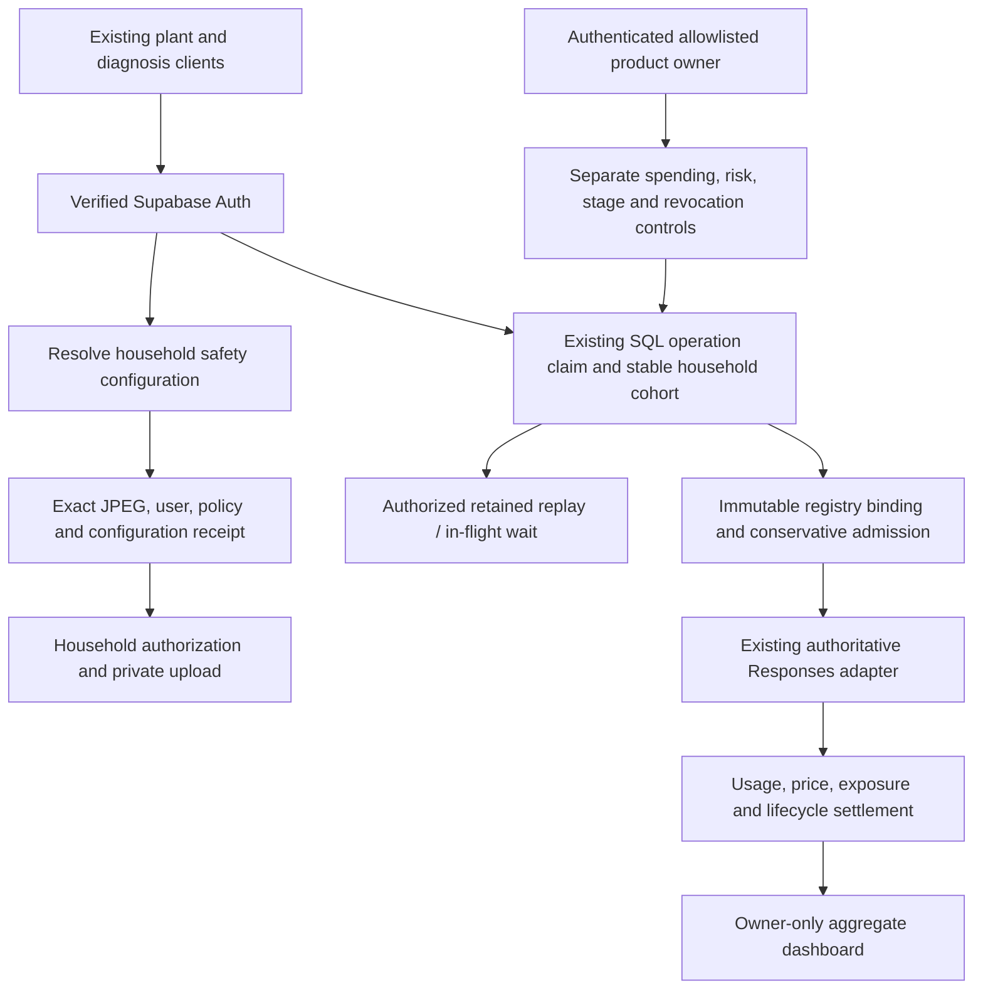

# Complete Luna migration — release record

## Current state

2026-11-16: **compatibility release DEPLOYED; final production cutover NOT VERIFIED**. Starting main was `4b89f42132a5a6e941190af57c4b146e84f1a03a`; deployed application revision is `18aa79931f210f63a249988c8c7cc9ecadea8470`. All four customer routes still use their original GPT-4o configurations, with Luna candidates disabled at 0%. No Terra provider calls were created.

The three additive migrations are applied (42 total). Nine affected Edge Functions, including authenticated owner controls, were deployed and their source/JWT/bundle metadata read back. Four unrelated functions, all seventeen secret digests, both private-bucket configurations, all original customer row hashes across sixteen tables, original prices/controls and all 218 original attempt facts were preserved. A fresh encrypted recovery archive was decrypt/parse verified before deployment; details are in the cutover record.

The identified owner was enrolled privately and a normal existing signed-in owner session recorded the exact campaign approval through the production UI. Plan SHA-256: `0a956fc2fd4348ba1df36556ea129236834cc96810f3f240f730108b00463bad`; cap 120 attempts/$4 aggregate measured/reserved/unknown exposure/60 minutes/one in flight, no reset/continuation/Terra. Three synthetic identities and two test households were created, with a test-only Premium grant confined to the new household. Customer entitlements were not changed.

**Executed safety comparison:** 44/44 measured Luna calls, $0.00912220, no new unknown exposure; each effort matched five allowed and seventeen rejected engineering reference labels. None is the proposed default; low showed no safety benefit in this set. Exact factual evidence SHA-256: `f4be0ded5a094ce82f203f2efc6942f3404a6c5e39b0d7e781110e5821073f9a`. Independent botanical reviews remain zero. The separate exact-hash owner risk decision and rollout grants are pending; spending approval does not activate customers. The single campaign must never be reset or reopened.

Current-revision application, PostgreSQL and full disposable Supabase CI jobs passed. The separate Pages packaging job failed its existing `RELEASE_DATABASE_CONFIGURATION_REQUIRED` condition; active Netlify revision, clean release manifest and published asset hashes passed independent verification. A deployment and a passing engineering fixture set are not complete migration.

## Architecture

Initial identification and care still share `plant-care-ai`; refresh uses its existing `manual_refresh` contract. Diagnosis still uses `plant-diagnosis-ai`. Validation and upload retain their existing endpoints, JPEG parser, authorization, private Storage and upload admission. All provider traffic uses `_shared/aiOperation.ts`; no second provider client/router is introduced.

The original sixteen configurations remain immutable for historical lookup and pricing. Eight configurations are eligible for this migration: Luna none/low for initial care, refresh, diagnosis and safety. Only the two safety definitions are new, with distinct `plant-image-safety-luna-{none,low}-v2` versions, the existing strict eight-field schema and 700-token ceiling. Care/diagnosis v1 prompts, JSON contracts, image profile and caps remain unchanged. New Terra evaluation/binding/operation/attempt paths are denied.

The compatibility deployment supports the currently active baseline while candidates remain disabled. Its default logical model is Luna; `OPENAI_MODEL` cannot choose a provider. Historical care/diagnosis fingerprint construction retains the old model marker solely as a replay identity. Actual provider payloads use the trusted SQL configuration. An existing operation is found before route selection, preserving old replay and in-flight pinning.

## Change boundaries

Additive migrations:

- `20261116103419_ai_luna_owner_controls.sql`: empty owner allowlist, immutable proposals/evidence/approvals, separate owner-risk state, stage grants, cutover metadata.
- `20261116104401_ai_luna_routing_and_safety.sql`: two safety configurations; explicit approval modes; Luna-only candidate/evaluation eligibility; safety resolver; campaign image/configuration allowlists; stage, cutover, recovery and provider-start guards. Default candidates remain disabled.
- `20261116105220_ai_luna_finops.sql`: owner-only state and ledger aggregates. No customer entitlement mutation or historical revenue backfill.

The one RevenueCat change retains the validated webhook environment in **new** sanitized event metadata. Billing decisions, plan mapping, secrets, customer binding and entitlements are unchanged. Historical events without environment remain unverified.

Frontend changes pass an optional household ID during prevalidation, reuse the existing invalid-receipt recovery, and add an owner-only Settings panel and explicit projection calculator. No model, reasoning, prompt or output-cap override is accepted as a provider choice.

## Release gates

1. Local tests, scoped security review and current-main CI, including disposable Supabase.
2. Fresh encrypted recovery checkpoint and preservation checks; reviewed additive migrations and affected-function source/JWT parity.
3. Enroll only the explicitly identified confirmed owner; actual owner session approves the exact spending proposal.
4. Execute the single bounded campaign. Both safety efforts tested; any known-disallowed acceptance makes that configuration ineligible. New unknown exposure stops the run permanently.
5. Register factual engineering/safety/financial evidence. Authenticated owner separately accepts exact hashes, limitations, initial maximum 5% canary, all explicitly listed stages and rollback conditions.
6. Apply stages 5/10/25/50/100 separately on each route; each advancement requires a fresh successful measured operation at the previous route version.
7. Drain legacy reserved/processing operations; commit all four Luna routes atomically. A database guard then rejects every new non-Luna operation/provider attempt, including legacy RPC paths.
8. Finish the runtime Luna-only restriction/legacy endpoint retirement, supported recovery and production smoke; preserve customer records, historical prices and the old unknown record. Record exact final revisions, CI, Edge versions and cutover timestamp in the release receipt.

See [cutover evidence](ai-production-cutover.md), [owner authorization](ai-owner-risk-acceptance.md), [safety](ai-luna-image-safety.md), [accounting](ai-luna-financial-accounting.md), [economics](ai-household-profitability.md) and [recovery](ai-luna-only-recovery.md).

GPT-4o retirement is January 14, 2027 according to the [official deprecations page](https://developers.openai.com/api/docs/deprecations). This preparation does not claim that migration has met that deadline or reached 100%.
