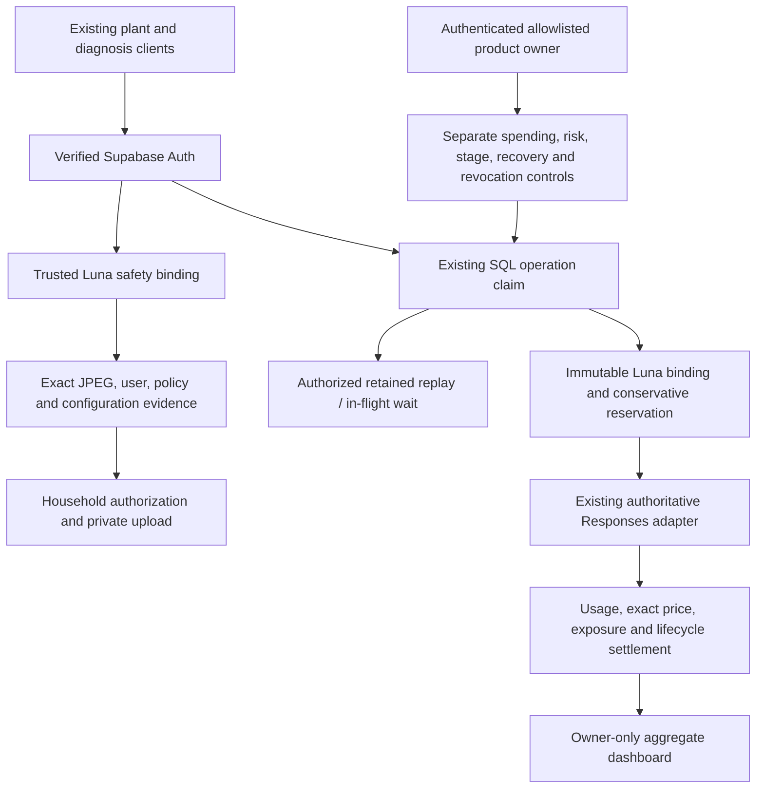

# Complete Luna migration — release record

## Final production state — 2026-11-16

**100% Luna cutover VERIFIED under authenticated owner-accepted unreviewed quality risk.** The atomic barrier committed at **2026-11-16T16:50:51.831557Z (17:50:51 CET)**. All four routes are unpaused, with Luna as their active binding for every household. Canary flags are disabled, candidate configurations NULL and rollout percentages zero because the canary is finished; AI remains available.

| Purpose | Active immutable configuration |
|---|---|
| Plant identification / initial care | initial_care:gpt-6-luna:none:v1 |
| Manual care refresh | care_refresh:gpt-6-luna:none:v1 |
| Diagnosis | diagnosis:gpt-6-luna:none:v1 |
| Image safety | image_safety:gpt-6-luna:none:v2 |

Starting main: `4b89f42132a5a6e941190af57c4b146e84f1a03a`. Implementation/cutover revision: **`b6dd4d1addf5d302420bc9f68ec1bf0361418209`**. The final documentation-head revision, CI jobs and actual published manifest are bound after commit in the private final-verification receipt, avoiding a self-referential hash.

Production `OPENAI_MODEL` is now `gpt-6-luna`, verified by digest; the other sixteen secret digests are unchanged. The actual provider selector is the immutable server configuration. Both strict Edge runtime and database admission reject new non-Luna work. Post-barrier readback found **zero GPT-4o / zero Terra provider attempts**. Historical configurations, prices, ledger records and authorized retained results remain intact.

All twenty authenticated owner grants for four routes × 5/10/25/50/100 stages were applied with their evidence gates. Both campaigns are permanently closed: **60 + 23 = 83 attempts / $0.019246015 measured / zero new unknown / zero pending**. All six synthetic accounts/sessions, four households and eight private objects were removed; financial history remains.

## Architecture and execution paths

Identification and initial care still share `plant-care-ai`; refresh uses its existing `manual_refresh` contract. Diagnosis uses `plant-diagnosis-ai`. Validation/upload retain exact JPEG verification, household authorization and private Storage. Every inference uses `_shared/aiOperation.ts`; there is no second provider client/router. Legacy Netlify handlers cannot generate AI. Authenticated vision/prompt evaluation endpoints return 410 without SQL/provider work; protected model evaluation remains registered and metered.

Logical/historical operation lookup precedes current-route selection. Existing operations stay pinned across configuration changes; completed authorized replay does not infer again. The old GPT-4o fingerprint marker is only identity, never model selection. Client model/reasoning/prompt/schema/cap overrides cannot select a provider. Unsupported/mismatched actual models or effort fail closed while usage settles or exposure remains held. Errors do not trigger an automatic second paid call.

The original sixteen configurations remain immutable. Eight Luna none/low definitions are eligible; only the two safety definitions are new. Safety v2 uses separate prompt/configuration namespaces, the strict eight-field output and 700-token cap. Care/diagnosis v1 prompts, schemas, five pills/three tips/watering interval, 1400/2400-token caps, normalized 1600px/high JPEG and response envelopes remain unchanged.

## Changed boundaries

- Shared registry/operation/safety/receipt modules, validation/upload/model evaluation, retired evaluators and new JWT-protected owner controls; care/diagnosis entry points were redeployed with their shared dependencies.
- Frontend optional household prevalidation context, existing invalid-receipt recovery, owner-only Settings controls and explicit profitability calculator.
- RevenueCat only retains validated environment metadata in new sanitized events. Billing decisions, mapping, secrets, customer binding and entitlements are unchanged; historical environment is not invented.
- Five additive migrations: owner authority/evidence, routing/safety, FinOps, exact fixture-format compatibility and scoped cutover updates. Production has44 migrations; no seed/role/Vault/customer reset.
- Tests/source-graph fixtures/full-history PostgreSQL CI. Historical adapter fixtures pin immutable18aa799; current Luna is tested separately.

Exact changed paths: `git diff --name-only 4b89f42132a5a6e941190af57c4b146e84f1a03a b6dd4d1addf5d302420bc9f68ec1bf0361418209`. The final documentation commit updates the twelve migration/routing/readiness records and removes one extra final blank line from the new cutover migration. No dependency/lockfile change, feature branch, staging backend, unrelated CSS or browser-assertion change.

## Evidence and known limitations

Fixed safety comparison: 44 requests/$0.00912220,22/22 engineering labels per effort, five ALLOW/seventeen REJECT, zero observed false acceptance/rejection. None cost 9.85% less than low with no observed safety improvement. Historical matched diagnosis generation cost fell 92.13% versus GPT-4o; different-population safety and composed journey comparisons remain explicitly labelled.

The completion run measured 23 successful strict-output responses/$0.005925740. After the barrier, the actual owner selected qualified care-refresh low, a new measured low operation succeeded, none was restored and a new measured none operation succeeded. Retained none replay during low cost zero; retained low replay after restoration was verified by a rolled-back service claim without inference.

Production Free limits: 10 plants / five monthly diagnoses/one daily refresh; Premium Viewer persistence, saves, private image hashes, outsider denial, valid safety reuse and exact actual model/effort were tested. The required application/PostgreSQL/disposable-Supabase CI jobs passed at the implementation revision. Separate GitHub Pages packaging still fails its existing database-configuration condition; active Netlify remained independently verified.

- Independent botanical/treatment/native-speaker review: **NOT EXECUTED**. Six of eight selected care identifications disagreed with public crop labels; two full-plant Ficus outputs matched. Historical Peperomia/tomato disagreement remains. No botanical non-inferiority or treatment-safety approval.
- Full-body oversized production HTTP assertion: **FAIL**, unresolved transport timeout; no application response/provider/storage effect. Actual1601px input was rejected with the unchanged 400 INVALID_IMAGE contract. Local/CI bounds and byte-identical deployed guards passed; no demonstrated bypass.
- Safety replay probe arrived eight seconds after five-minute expiry: zero-cost assertion **FAIL**, fresh metered revalidation **$0.00005005** included in23. Maximum provider attempts per operation: 1.
- Optional production signed-receipt issuance and physical Android/iOS: **NOT EXECUTED**. Server-cache fallback/reuse and local forged/stale receipt tests passed.
- Collected-revenue profitability: **NOT VERIFIED**. €3.99 projections use explicit deductions/usage assumptions; arbitrary unlimited unique inference cannot guarantee profit.
- Historical **$0.26355 UNKNOWN_USAGE** remains unresolved and unchanged. Existing database advisor warnings remain.

See [all verification statuses and deployment evidence](ai-production-cutover.md), [reasoning](ai-luna-reasoning-benchmark.md), [safety](ai-luna-image-safety.md), [accounting](ai-luna-financial-accounting.md), [economics](ai-household-profitability.md), [owner authority](ai-owner-risk-acceptance.md) and [Luna-only recovery](ai-luna-only-recovery.md).

**GO for the verified Luna-only production service under explicit owner-accepted unreviewed risk.** This is not independent botanical approval or a profitability guarantee. GPT-4o retirement was verified as January14,2027 from the [official deprecations page](https://developers.openai.com/api/docs/deprecations); actual cutover predates it.
