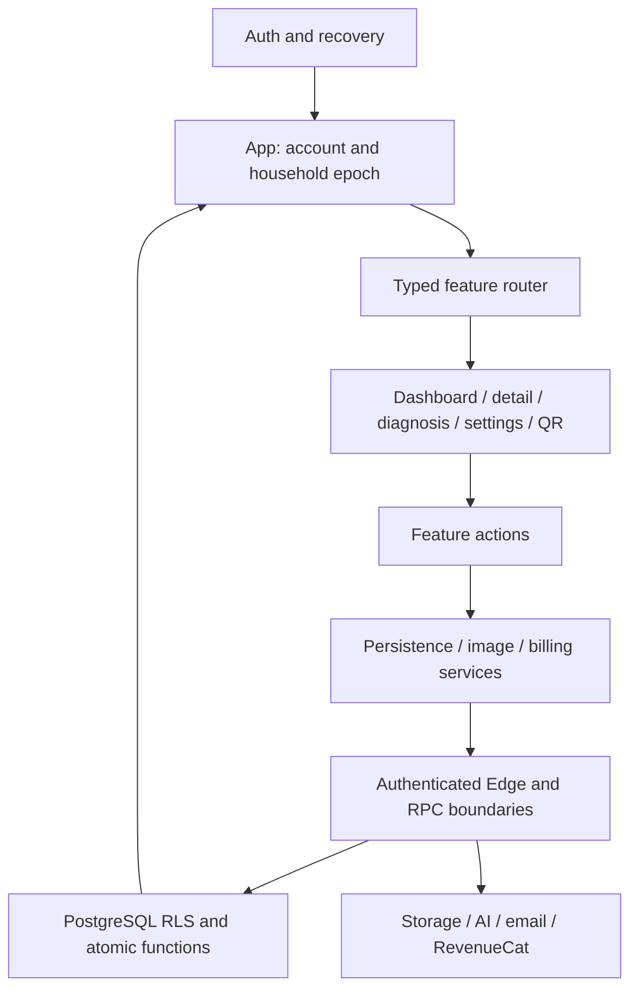

# Plantie V3 architecture and performance

This report describes the local changes after baseline `2e8e933`. It complements the [findings](v3-findings.md), [validation](v3-validation.md), and [rollout](v3-rollout.md) reports.

## Boundaries and state ownership

Previously, `App.tsx` rendered the dashboard, detail, diagnosis, settings and QR screens and implemented their mutation workflows. The earlier Add Plant extraction covered only its modal, grid and creation service.

The current application uses these boundaries:

| Boundary | Responsibility |
| --- | --- |
| `src/App.tsx` | Auth/recovery gates, selected household and generation, authoritative read state, compatibility synchronization, shared scope resets, feature composition and global navigation. |
| `src/app/AppRouter.tsx` | Typed private-screen composition; detail, diagnosis, settings and QR screens load lazily. Dashboard remains eager. |
| `src/app/FeatureBoundary.tsx`, `AppErrorBoundary.tsx` | Loading and safe localized render failures. A feature failure can return to plants; global failure offers reload. |
| `features/plants` | Dashboard cards, Add Plant presentation, detail presentation, creation service, persistence adapter and add/rename/remove actions. Persistence explicitly returns success/failure. |
| `features/diagnosis` | Diagnosis picker/modal/history presentation and generation/save/history actions. |
| `features/care` | Care preview comparison and generation/apply actions. Failed persistence preserves the preview. |
| `features/households` | Creation, selection, rename and household sheet. Selection invalidates outstanding household operations before replacing shared state. |
| `features/invitations` | Inbox/review and owner invitation/member actions; completed account mutations refresh the directory even after review closes. |
| `features/settings` | Menu composition and authenticated deletion-review controller/copy. |
| `features/auth` | Recovery completion/retry controller; underlying `useAuth`, `AuthPanel` and auth service retain their existing responsibilities. |
| `features/qr` | QR page presentation; global entitlement/scope eligibility remains in App. |
| Existing pricing/billing components and services | Product display, checkout intent, provider adapters, subscription snapshots and household binding. Purchase continuations now require the same mounted scope epoch. |

Features receive explicit typed inputs and services. There is no new application-wide mutable context, state framework or runtime dependency. Some form state remains hoisted to preserve the existing cross-route and household-reset behavior. App is substantially smaller but remains a large composition/lifecycle module; this is not a claim that every form state or synchronization effect has been independently encapsulated.

The scope owner checks account/household identity between asynchronous steps. Screen-level purchase intent additionally uses a mounted epoch, so an unmounted screen or A-to-B-to-A household transition cannot revive the original continuation. A provider action already started cannot be retrospectively canceled by React.

## Shared reliability components

`ModalDialog` owns focus trapping/restoration, topmost Escape handling, viewport adaptation and reference-counted scroll locking. Plant, care, household, authentication and upgrade dialogs retain their own content/classes. Pricing cancellation and the invitation popover retain their specialized behavior while sharing scroll locking. The production stylesheet is unchanged.

`awaitAbortableOperation` settles a caller at cancellation/deadline even if an external adapter ignores cancellation. It observes late failures and can dispose late resources. Image operations keep their existing interface. `withRequestTimeout` uses this behavior and clears timers/listeners. Netlify fallback response parsing is inside the deadline; the compatibility deletion endpoint bounds its complete auth/RPC operation.

Image safety receipts remain session-only and bounded. A supplied receipt explicitly rejected with `IMAGE_VALIDATION_REQUIRED` is forgotten and the same processed bytes/upload identity are retried once without it. The server then repeats safety validation. Network ambiguity, permission denial and unsafe content do not trigger automatic upload retries.

## Source graph and dependencies

Run `npm run check:source-graph`; generate an ignored `.tmp-tests/source-graph.json` report with `node scripts/analyze-source-graph.mjs --write`. The [analyzer](../scripts/analyze-source-graph.mjs) resolves relative TypeScript imports in `src`, Netlify functions and Edge functions, including URL-loaded workers, and detects runtime/dynamic cycles. Package-internal imports, third-party implementation and computed runtime imports are outside this graph. Generated reports are not maintained source files.

The only added package is exact development dependency `pg@8.16.3`, justified by independent-session PostgreSQL concurrency verification. Existing PGlite cannot establish cross-session row-lock behavior. The lockfile also resolves the existing busboy dependency to 3.2.3. No production dependency or application API framework was added.

## Measured production bundle

Same checkout configuration and Vite toolchain, before feature extraction versus the verified V3 build:

| Measure | Baseline | V3 | Difference |
| --- | ---: | ---: | ---: |
| Main application JS | 972.93 kB | 872.21 kB | -100.72 kB (10.35%) |
| Main application JS gzip | 277.93 kB | 254.07 kB | -23.86 kB (8.59%) |
| Application stylesheet | 129.08 kB | 129.08 kB | unchanged |

These are emitted chunk sizes, not total downloaded assets or measured time to interaction. Detail/settings/diagnosis/QR chunks are deferred. Existing HEIC worker, QR/PDF and provider SDK boundaries remain. Large deferred vendor chunks still produce Vite's size warning; the warning was not suppressed.

The offline assembled-app workload completes ten additions with ten validation requests and ten care requests. This demonstrates no duplicate submission-time validation in that controlled path. Signed receipts separately avoid repeated server safety work and receipt-recovery tests cover invalidation. Real provider latency, production request waterfalls, device peak memory, React production render profiles and field error rates were not measured; no improvement in those metrics is claimed.

## Remaining technical debt

`plantieRepository.ts` remains a broad typed API module, and App still coordinates substantial shared lifecycle state. Further extraction should follow changed feature ownership rather than move setters into another global object. Legacy Netlify compatibility cannot be removed until deployed consumers are verified. Full Supabase-stack tests, live provider behavior and native device behavior remain separate release gates described in the validation report.
